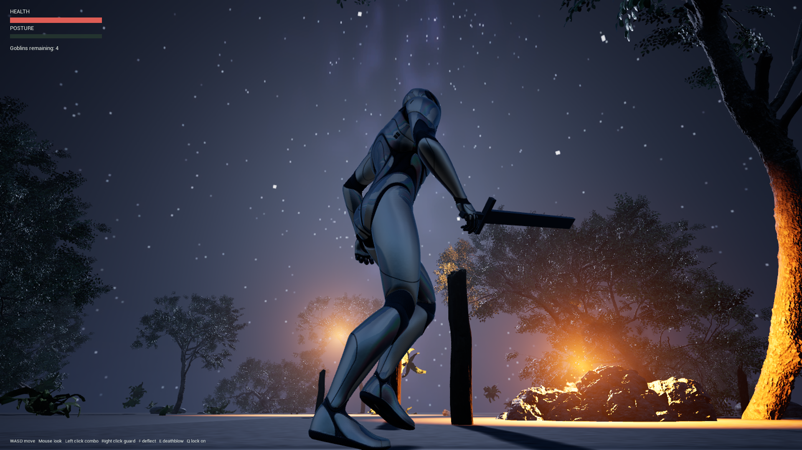

# DarkForest

DarkForest is a short third-person sword-fighting demo built in Unreal Engine 5.3 with C++. Ordinary goblins teach the timing of a deflect. The Goblin King asks you to use it under pressure: break his posture, land a deathblow, and take away one of his three health segments.

## Download for Windows

Download: [DarkForest-v1-Windows-x64.zip](https://github.com/vyasom1/DarkForest-v1/releases/download/v1.0.0/DarkForest-v1-Windows-x64.zip) (515 MB). Extract the entire ZIP and double-click `MyProject.exe`. Unreal Editor is not required.

## What I worked on

- **Sword hit detection** — [`DarkForestHero.cpp`](Source/MyProject/Player/DarkForestHero.cpp) (`ResolveSwordHit`): a sampled hit check that runs through the active part of the swing, accounts for the enemy capsule, and remembers which enemies a swing has already hit.
- **The King's posture and phase transitions** — [`GoblinKingPhaseComponent.cpp`](Source/MyProject/Enemy/GoblinKingPhaseComponent.cpp): posture damage, posture break, deathblow, and segment removal that advances the phase.
- **HUD that responds to combat events** — [`BossHealthWidget.cpp`](Source/MyProject/UI/BossHealthWidget.cpp): segmented health, posture, phase, and windup/punish cues driven by the boss state.

### Controls

| Input | Action |
| --- | --- |
| WASD, mouse | Move and look |
| Left mouse button | Attack |
| Right mouse button | Guard |
| F | Timed deflect |
| Q | Lock on |
| E | Interact, advance scenes, or deathblow when prompted |
| V | Skip a scene |
| P | Pause |

## Two bugs that shaped the combat

One click used to play the whole sword combo. All three attack entries pointed to the same 5.47-second animation, so the first swing looked like the player had already committed to the entire sequence. I split the clip into three strikes and gave each one its own attack data. In the editor test, one input played the first strike and the character returned to idle.

A swing could look like it connected while the goblin lost no health. I changed the hit check to run throughout the active part of the swing and account for the enemy capsule. Each swing remembers which enemies it has already hit, so a longer contact still deals damage only once. In one test, a frontal strike took a goblin from 90 health to 65. Facing away or swinging from 600 cm away dealt no damage.

## Tools, assets, and verification

I used AI assistance for parts of the implementation, debugging, and documentation. I tested the packaged Windows build on my own machine. The source snapshot includes 20 Unreal automation tests covering combat, boss phases, and damage numbers; a separate 33-check setup script verified the boss HUD bindings. 30 FPS on a GTX 1650 is a target, not a measured packaged result.

Third-party assets and generated cinematics are credited in [ATTRIBUTION.md](ATTRIBUTION.md) and [docs/ASSET_MANIFEST.json](docs/ASSET_MANIFEST.json). The opening and ending cinematics use Google Gemini/Veo; their redistribution permission is being confirmed before the Windows build is published.

## Where DarkForest goes next

This is the first public version of DarkForest. I'm keeping the scope small while I work on how each fight feels. The next things I want to polish are the transition from a goblin's approach into its first swing, the sound of a successful deflect, and how clearly the King signals an opening. Updates will come gradually as I playtest each change.

For my next Unreal project, I want to build something that's easier to expand. One goal is to add an enemy or encounter without having to rewrite the combat system each time.

## Feedback and contributions

If you try the demo, I'd love to hear about one fight that felt good or one hit you couldn't read. Open a [GitHub issue](https://github.com/vyasom1/DarkForest-v1/issues) and tell me what happened. If you'd like to contribute code, animation, sound, or playtesting, you're welcome to open an issue with your idea so we can talk it through.